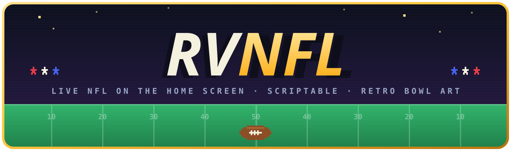
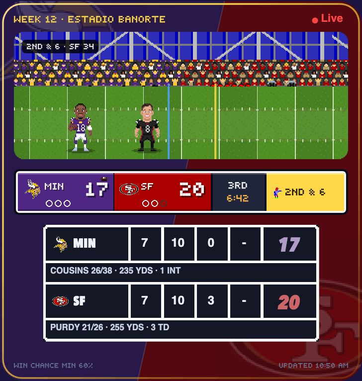
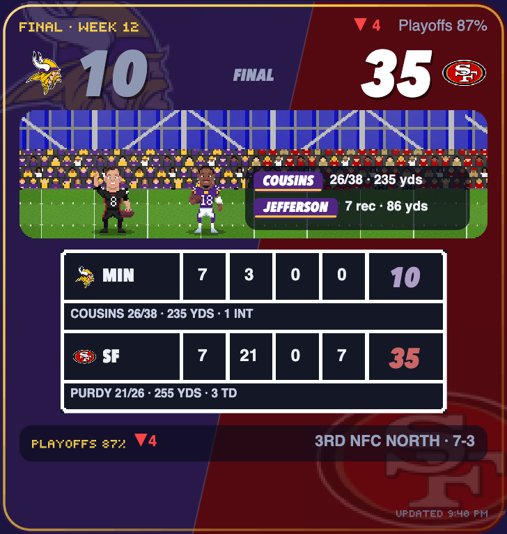
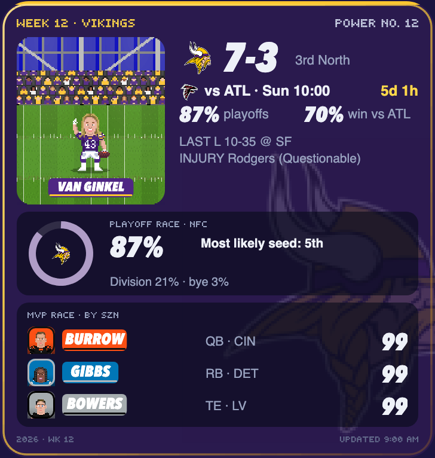

<p align="center">
  <a href="https://sakisaki-dev.github.io/RetroVault-NFL/"></a>
</p>

<p align="center">
  <a href="https://sakisaki-dev.github.io/RetroVault-NFL/"></a>
</p>

**Retro Vault NFL** is a fan-made NFL stats hub: every player's career since 1999, team and season pages, a live
season view, a college draft section, ten arcade games, a card collection and an iPhone widget. It is the NFL
edition of Retro Vault, drawn in the pixel art of *Retro Bowl*. Phone-first, installable to the home screen.

There is no server. Python scripts turn public data into JSON files, a React app reads them, and GitHub Actions
publishes the site and refreshes the widget data every morning.

**Live site: https://sakisaki-dev.github.io/RetroVault-NFL/**

## Contents

[What's in the site](#whats-in-the-site) · [Data](#data) · [Daily data job and deploy](#daily-data-job-and-deploy) ·
[iPhone widget](#iphone-widget) · [Run it locally](#run-it-locally) · [Tech stack](#tech-stack) ·
[Project layout](#project-layout) · [Credits](#credits)

## What's in the site

The dock has **Season**, **Stats**, **Arcade** and **News**; **More** holds College, Team Lab and Collection.

| Tab | What it does |
|---|---|
| **Season** | The season as it is played: standings, scores and games, league leaders, the playoff race with odds and a club wall |
| **Stats** | **Players** (record book, leaderboards, analytics), **Teams** (a sheet per club), **Graphs** (scatter and comparison charts), **Head-to-Head** (two players side by side) and **Deep Dive** (one player's career graphs, comps and ratings) |
| **Arcade** | Ten games on the same data: Can you go 18-0?, Blind Rank, Keep 3 / Cut 3, Guess the Legend, Higher or Lower, League Grid, Who's the Imposter?, Six Degrees of the NFL, Over/Under, Build-a-Legend |
| **News** | Live NFL headlines and video from ESPN, read inside the site |
| **College** | Draft boards, a page per school and a draft war room |
| **Team Lab** | Build a lineup and get a scouting report |
| **Collection** | Card packs, a binder, shard workshop, card market and exchange, kept in the browser |

Also: quick search for players and clubs and a player card on every name. The Hall of Fame is shown as a plain fact on a player's card (the real Pro Football
Hall of Fame inductees).

## Data

Everything the site shows is generated into `public/data/` by scripts in `scripts/` (and `scripts/nfl/`); nothing
is typed in by hand.

| Source | Used for |
|---|---|
| [nflverse](https://github.com/nflverse/nflverse-data) (CC-BY 4.0) | Players, careers, schedules, rosters, injuries, depth charts, snap counts, contracts, draft |
| ESPN public APIs | Live scores and game summaries, headlines and video, team and college logos and ids |

Ratings (career OVR and the season rating SZN), skill grades, records, the playoff model and the card market are
computed from that data by rules, so a rebuild on the same inputs gives the same files.

## Daily data job and deploy

| Workflow | What it does |
|---|---|
| [`nfl-widget-daily.yml`](.github/workflows/nfl-widget-daily.yml) | Every morning (and on demand) downloads the season's nflverse files, rebuilds the widget feed (injuries, depth charts, SZN, playoff odds, `widget.json`) and commits it to the **`widget-data`** branch, never to `main` |
| [`deploy-nfl-pages.yml`](.github/workflows/deploy-nfl-pages.yml) | On every push to `main`: builds the site with `VITE_EDITION=nfl`, adds the widget files and the latest `widget.json` under `/widget/`, and publishes to GitHub Pages |

## iPhone widget

A [Scriptable](https://apps.apple.com/app/scriptable/id1405459188) widget that follows one club (the Vikings by
default). One script covers every size, including the lock screen, and picks a view by the moment:

| When | Shows |
|---|---|
| The club's game is live | Score, clock, down and distance, the drive, leaders, win probability |
| Another primetime game is live | The same live view for that game |
| Sunday | The slate of games, or a score ticker on medium and small |
| After the game | The final, its stars and how the playoff odds moved |
| The day before | Preview: opponent, kickoff, win chance, injuries |
| Weekdays | Club card, playoff race, MVP race |
| Offseason | The season in the books |

<p align="center">
  
  
  
</p>

**Install**

1. Install Scriptable on the iPhone.
2. Create a script named **RV NFL** and paste in [`public/widgets/rv-nfl-install.js`](public/widgets/rv-nfl-install.js). Run it once.
3. Add a Scriptable widget (any size, or a lock screen one) and choose **RV NFL**.

No key or account needed. The installer fetches the latest widget code on every refresh and keeps a cached copy for
offline use. The widget's Parameter field is optional: empty opens the site, `bug` or `classic` pins the live view
style, a Shortcut name runs it, a URL opens it.

**Refresh.** Every 5 minutes while the club plays, every 10 while other games are live, at kickoff before a game, and
once in the morning on weekdays (iOS treats these as hints). Data comes from the `widget-data` branch (raw GitHub,
then Pages, then cache); live scores come straight from ESPN. More in [`widget/README.md`](widget/README.md).

## Run it locally

Needs Node 20+ and Python 3. **Every NFL build, dev server or preview needs `VITE_EDITION=nfl`**; without it you
get the other edition.

```bash
npm install
npm run nfl:dev            # dev server on :4174 (sets VITE_EDITION=nfl)
npm run nfl:build          # production build into dist/
VITE_EDITION=nfl npm run preview
```

Rebuild the data (downloads nflverse files into a git-ignored cache first):

```bash
python3 scripts/nfl/fetch.py   # download nflverse data (add --all to refetch everything)
npm run nfl:rebuild            # players, ratings, records, season/college/news data, widget feed, audit
npm run nfl:sprites            # player sprites, kit colours, jersey numbers (only when needed)
```

Building for a static host (what the Pages workflow does):

| Variable | Meaning |
|---|---|
| `VITE_EDITION=nfl` | Build the NFL edition |
| `BASE_PATH=/RetroVault-NFL/` | URL path the site is served under |
| `VITE_STATIC_HOST=1` | No dev proxy: ESPN articles are fetched straight from ESPN |

## Tech stack

Vite, React 18, TypeScript, Tailwind CSS and Radix UI; hash routing; Python (standard library plus the build
scripts) for the data pipeline; GitHub Actions and GitHub Pages; the widget is plain JavaScript for Scriptable.

## Project layout

| Path | What's there |
|---|---|
| `src/` | The app: `components/` (tabs, stats, season, college, games, collection, team lab...), `utils/`, `config/` |
| `scripts/nfl/` | NFL data pipeline: fetch, players, ratings, season, draft, college, news, widget feed, audit |
| `scripts/` | Shared builders (league data, SZN, records, Hall of Fame) and sprite tooling |
| `data/nfl/` | Source inputs for the build (the nflverse download cache is git-ignored) |
| `public/data/` | Generated JSON the site loads (never hand-edited) |
| `public/widgets/` | `rv-nfl-widget.js` and `rv-nfl-install.js` |
| `widget/` | Widget data build (standard-library Python), inputs and README |
| `docs/` | Notes on formulas and mechanics |
| `.github/workflows/` | Daily data job and Pages deploy |

## Credits

- **Data:** [nflverse](https://github.com/nflverse/nflverse-data) (CC-BY 4.0) and ESPN's public endpoints; club logos are ESPN's.
- **Art:** the pixel sprites, crowd, stands and turf are *Retro Bowl* art by [New Star Games](https://www.newstargames.com/), used for a personal fan project.

**Not affiliated.** Fan-made. Team names and logos belong to their respective owners; this project is not affiliated
with or endorsed by the NFL, the NFL Players Association, any club, ESPN, New Star Games or any league or team.

Built by [sakisaki-dev](https://github.com/sakisaki-dev).
